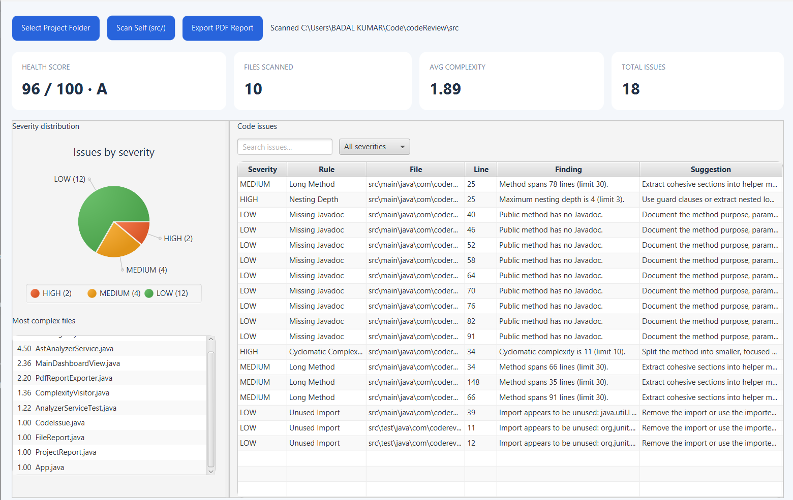

# CodeReview Buddy

**Institution:** Netaji Subhas University of Technology  
**Subject:** Advance Programming (`ITITC304`)  

A Java 21 static code analysis tool that scans Java source files, detects code quality issues, computes a project health score, and generates structured review reports.

## Team Members
| Name | Roll No. | Assigned Module |
| :--- | :--- | :--- |
| Badal Kumar | 2025UIT3109 | Project Architecture, Maven Setup & File Scanner |
| Harish | 2025UIT3088 | Static Analysis Rules Engine & Issue Scoring |
| Vikas | 2025UIT3093 | Health Score Calculation & Report Generation |
| Gaurav | 2025UIT3122 | CLI / Web Interface|
| RAKHI kirar| 2025UIT3101| JUnit 5 Testing & Docs |

## Screenshot


## Key Features
- Recursively scans Java source directories (`java.nio.file`) and analyzes class/method AST structures
- Detects code smells, naming violations, high method complexity, and resource leaks
- Computes an overall repository health score (e.g., `98/100 A`) with severity breakdowns
- Exports structured review summaries for scanned files
- Includes JUnit 5 unit tests verifying scanner accuracy and rule checks

## Technologies Used
- **Java 21** (OOP, Collections, Streams, Java NIO)
- **JavaParser & Gson** (AST parsing and JSON reporting)
- **JUnit 5** (Unit testing)
- **Apache Maven** (Build & dependency management)

## How to Run
1. **Clone the repository:**
   ```powershell
   git clone [https://github.com/badalkumar7/CodeReview-Buddy.git]
   cd CodeReview-Buddy
